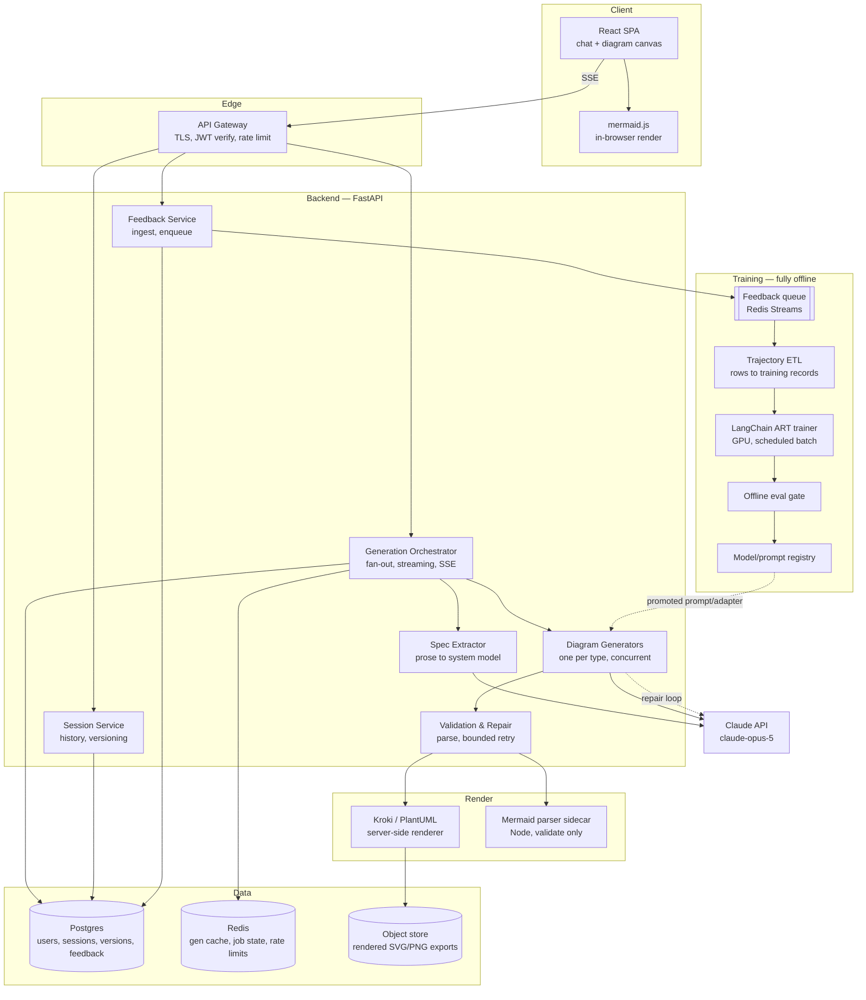
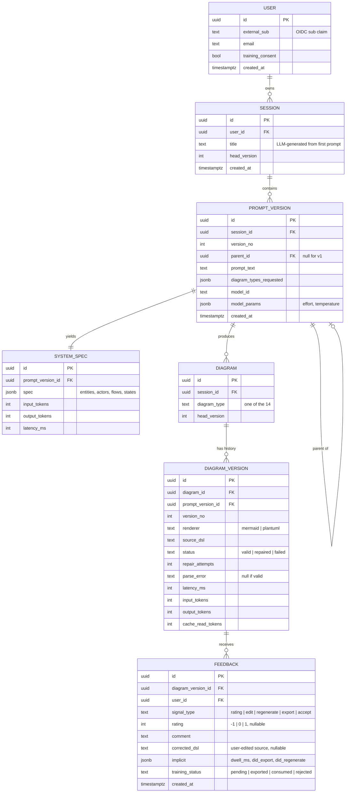
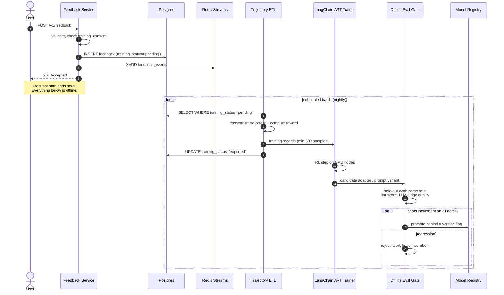
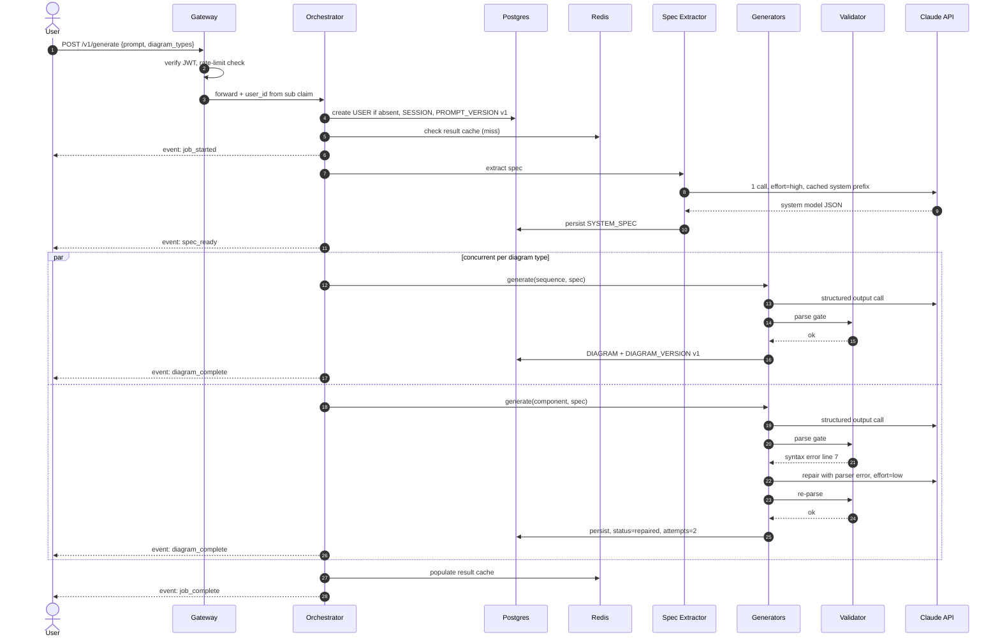
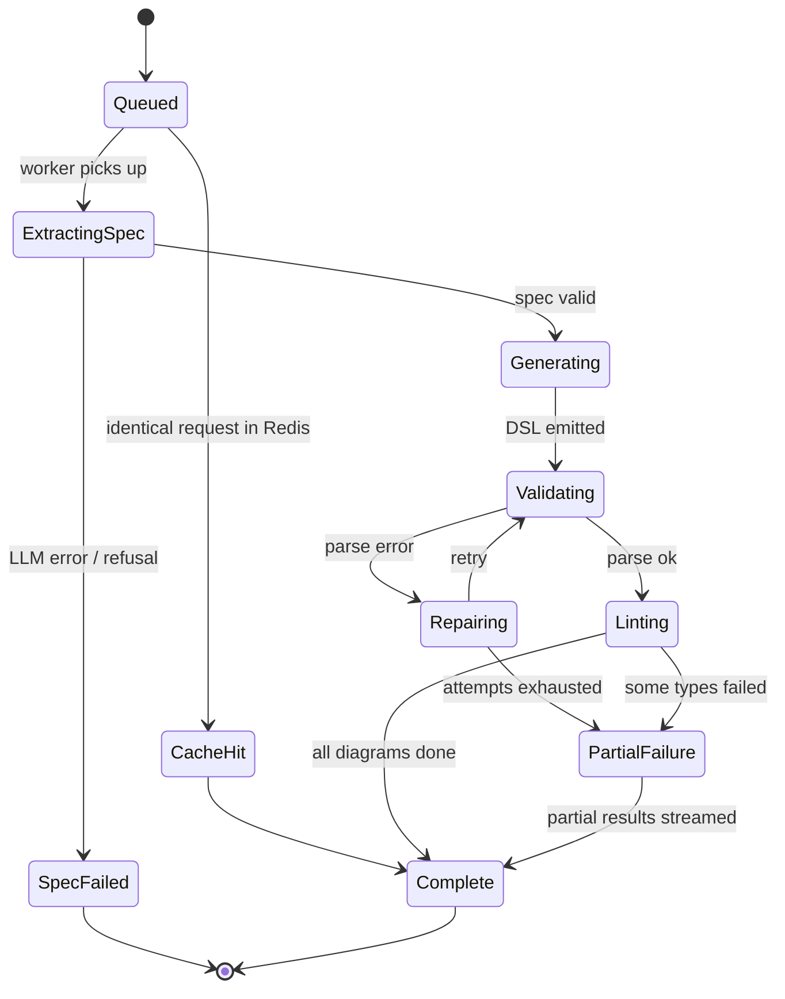

# HLD — UML Diagram Generation Chat Platform

**Status:** Draft for review
**Date:** 2026-10-15
**Scope:** High-level design for a chat platform that converts a natural-language software-design prompt into rendered UML diagrams, supports iterative refinement, and feeds user feedback into a LangChain ART RL trainer.

---

## 1. Assumptions

The source brief specifies the input contract, three user flows, and four technical questions. It does **not** specify auth, scale, latency targets, storage, or tenancy. The following are design decisions made to unblock the HLD. Each is cheap to revise; none is load-bearing on the architecture.

| # | Area | Assumption | Rationale |
|---|---|---|---|
| A1 | Identity | Auth is **required**, not optional | The brief's three flows are "new user" / "existing user" / "existing user" — these are indistinguishable without stable user identity, and feedback must be attributable to a training example |
| A2 | Auth mechanism | OIDC via a managed provider (Auth0 / Cognito / Clerk); JWT bearer tokens; no self-built password handling | Identity is not the interesting part of this problem; outsource it |
| A3 | Authorization | Flat ownership model — a user reads/writes only their own sessions, prompts, and diagrams. No orgs, roles, or sharing in v1 | Brief implies single-user interaction; multi-tenancy is a v2 concern |
| A4 | Scale | ~10k registered users, ~2k DAU, ~5 generations/user/day ⇒ **~10k generations/day**, peak **~10–15 concurrent generations** | Deliberately modest. The honest consequence: the bottleneck is **LLM inference and GPU training capacity, not the web tier** |
| A5 | Latency SLO | p50 **< 3s to first rendered diagram**; p95 **< 10s** for a 3-diagram request; first token < 1.5s | "Minimize latency" needs a number to design against. First-diagram-visible is the metric users feel, not last-diagram-complete |
| A6 | Availability | 99.5% for the read/chat path. Generation is best-effort with graceful degradation (serve cached/partial results) | LLM upstream is a hard dependency we don't control |
| A7 | Diagram budget | Max **6 diagram types per request**; prompt capped at 8k characters | Bounds fan-out cost and worst-case latency |
| A8 | Language/stack | Python 3.12 + FastAPI backend; React + Vite frontend | LangChain and ART are Python-native; the brief mandates ART, so Python is effectively fixed |
| A9 | Model | `claude-opus-5` via the Anthropic SDK | Highest-capability model; diagram generation is reasoning-heavy and quality dominates cost at this volume (see §9) |
| A10 | Retention | Prompts/diagrams retained indefinitely (user-deletable); feedback retained indefinitely as training data, with explicit consent at signup | RL training requires durable history. Consent is non-negotiable since prompts may contain proprietary design detail |

**Explicitly out of scope for v1:** real-time collaboration, diagram sharing/public links, org/team accounts, SSO-enterprise, on-prem deployment, round-trip code generation from diagrams.

---

## 2. Requirements

### 2.1 Functional

| ID | Requirement | Brief reference |
|---|---|---|
| F1 | Accept `{prompt, diagram_types}` and return rendered UML diagrams | Input contract |
| F2 | Render diagrams in the browser, with export (SVG/PNG) and source-text view | Technical Q1 |
| F3 | Guarantee syntactically valid diagram source before it reaches the user | Technical Q2 |
| F4 | **Flow 1** — New user: request in, diagrams out, session created | Case 1 |
| F5 | **Flow 2** — Existing user, revised prompt: produce an updated diagram set with prior context, preserving version history | Case 2 |
| F6 | **Flow 3** — Existing user feedback: capture, persist, and route to the LangChain ART plugin for future model improvement | Case 3 |
| F7 | Infer a sensible `diagram_types` set when the caller omits it | Quality-of-life; makes the parameter optional |
| F8 | Conversational history per session (chat platform, not a one-shot form) | "chat platform" |

### 2.2 Non-functional

- **Latency** — per A5; streaming responses so perceived latency tracks first-diagram, not full completion.
- **Correctness** — zero syntactically-invalid diagrams surfaced to users; a generation that cannot be repaired fails loudly with the parser error, never silently renders broken output.
- **Cost** — target < $0.10 per multi-diagram generation (see §9 for the arithmetic).
- **Observability** — every generation emits structured telemetry: per-stage latency, token usage, cache-hit rate, repair attempts, parse failures.
- **Training isolation** — the RL training path must never sit in the request path. A trainer outage degrades nothing user-facing.

---

## 3. API Contract

The brief gives the *minimum* input. The extended contract adds identity and conversation lineage.

### `POST /v1/generate` (SSE)

```json
{
  "session_id": "ses_41a",
  "parent_version": 3,
  "prompt": "I am working on a compliance monitoring solution which will pull in the latest circulars from SEBI and parse them...",
  "diagram_types": ["sequence", "component", "class"],
  "options": { "effort": "high", "stream": true }
}
```

- `user_id` is **never client-supplied** — it is derived from the JWT `sub` claim. Accepting it in the body would be a trivial IDOR.
- `session_id: null` ⇒ Flow 1 (new conversation). Present ⇒ Flow 2.
- `parent_version` makes updates explicit and idempotent-ish; omitting it means "branch from head".
- `diagram_types` optional ⇒ triggers F7 inference.

**Response:** `text/event-stream`. Events arrive out of order by design — each diagram streams as it finishes:

```
event: job_started      data: {"job_id":"job_77","version":4,"expected":["sequence","component","class"]}
event: spec_ready       data: {"entities":[...],"actors":[...],"flows":[...]}
event: diagram_complete data: {"type":"component","renderer":"mermaid","source":"graph LR\n...","attempts":1}
event: diagram_failed   data: {"type":"class","error":"unresolved participant 'Clause'","attempts":3}
event: job_complete     data: {"version":4,"succeeded":2,"failed":1,"latency_ms":4120}
```

### Other endpoints

| Method | Path | Purpose |
|---|---|---|
| `GET` | `/v1/sessions` | List user's sessions (paginated) |
| `GET` | `/v1/sessions/{id}` | Session with full version history |
| `GET` | `/v1/diagrams/{id}/versions` | Version chain for one diagram |
| `GET` | `/v1/diagrams/{id}/export?format=svg\|png` | Rendered export |
| `POST` | `/v1/feedback` | **Flow 3** — submit feedback (see §7) |
| `POST` | `/v1/sessions/{id}/fork` | Branch a session from an earlier version |
| `GET` | `/v1/diagram-types` | Capability matrix: the 14 types + which renderer backs each |

---

## 4. Architecture



### Component responsibilities

**API Gateway** — TLS termination, JWT signature verification, per-user rate limiting (token bucket in Redis: 20 generations/hour, 200/day). Rejects oversized prompts before they reach application code.

**Generation Orchestrator** — owns the request lifecycle. Resolves session context, creates the version row, fans out per-diagram work concurrently, multiplexes results into one SSE stream, persists outcomes. This is the only component that knows about streaming.

**Spec Extractor** — the key architectural decision. One LLM call converts the prose prompt into a normalized JSON **system model** (entities, attributes, actors, services, flows, states, deployment nodes). See §6.2 for why this exists.

**Diagram Generators** — N stateless workers, one per requested type. Each consumes the shared system spec plus a type-specific prompt template and emits diagram DSL. Concurrent, independent, individually retryable.

**Validation & Repair** — deterministic parse gate plus a bounded LLM repair loop. Never optional, never bypassed. See §6.1.

**Session Service** — conversation history, append-only version chains, fork/branch.

**Feedback Service** — write path for Flow 3. Persists to Postgres and enqueues to the training pipeline. Returns 202 immediately; nothing about training is synchronous.

---

## 5. Data Model



### Design notes

- **Append-only versioning.** A revised prompt (Flow 2) never mutates a row; it writes a new `PROMPT_VERSION` with `parent_id` set and new `DIAGRAM_VERSION` rows. This gives free history, rollback, forking, and — critically — a clean before/after pair for RL training.
- **`SYSTEM_SPEC` is persisted, not recomputed.** It is the expensive intermediate. Reusing it on a minor prompt revision skips the costliest stage, and it's part of the training trajectory.
- **Token counters live on `DIAGRAM_VERSION`.** `cache_read_tokens` is explicitly tracked because it is the single best diagnostic for whether prompt caching is actually working (§6.3).
- **`FEEDBACK.training_status`** gives the ETL an idempotent cursor; records are never double-consumed.
- Indexes: `SESSION(user_id, created_at DESC)`, `PROMPT_VERSION(session_id, version_no)`, `DIAGRAM_VERSION(diagram_id, version_no)`, `FEEDBACK(training_status, created_at)` — the last one is the ETL's hot path.

---

## 6. The Four Technical Questions

### 6.1 Q1 — How to generate and render UML on the UI

**Decision: a dual-renderer strategy, routed by diagram type.**

Neither available renderer covers all 14 UML types, so picking one is a false choice:

| | Mermaid | PlantUML (via Kroki) |
|---|---|---|
| Runs in browser | ✅ `mermaid.js`, zero server hop | ❌ needs a JVM service |
| UML type coverage | ~7 of 14 (class, sequence, state, ER, flowchart≈activity, C4≈component, timeline) | **All 14**, including object, deployment, use case, composite structure, timing |
| Render latency | ~50ms client-side | ~200–400ms + network |
| LLM familiarity | Very high — abundant in training data | High |
| Infra cost | Zero | A container to run and scale |

**Routing rule:** generate Mermaid for the types it supports natively; fall back to PlantUML for the rest. The `GET /v1/diagram-types` capability matrix is the single source of truth, consumed by both the generator prompt templates and the frontend.

```
mermaid    → class, sequence, state_machine, activity, component, use_case*, package*
plantuml   → object, composite_structure, deployment, profile, communication,
             interaction_overview, timing
```
<sub>\* approximated in Mermaid via flowchart/C4 constructs; flagged in the matrix so we can migrate them to PlantUML if fidelity complaints appear.</sub>

**Why client-side rendering matters beyond latency:** the diagram source is text, so the client can re-render instantly on user edit. That enables the inline "edit the DSL and see it update" affordance — which is also our highest-value feedback signal (§7).

**UI shape:** split pane — chat transcript left, diagram canvas right with a tab per diagram type. Each tab offers rendered view / source view / export. Diagrams appear progressively as `diagram_complete` events arrive, each starting as a skeleton placeholder. Export: client-side SVG serialization → `canvas` → PNG for Mermaid; Kroki returns SVG/PNG directly for PlantUML, cached in S3.

### 6.2 Q2 — How to control and verify syntax issues in the output

**Four layers, cheapest and most deterministic first.** The principle: never ask the LLM to be careful when a parser can be certain.

**Layer 1 — Structured output eliminates envelope errors.** Using `output_config.format` with a JSON schema means the response is *guaranteed* valid JSON matching our shape. This deletes an entire failure class — no markdown fences, no "Here's your diagram:" preamble, no truncated code block:

```python
response = client.messages.create(
    model="claude-opus-5",
    max_tokens=16000,
    thinking={"type": "adaptive"},
    output_config={
        "effort": "medium",
        "format": {
            "type": "json_schema",
            "schema": {
                "type": "object",
                "properties": {
                    "diagram_type": {"type": "string"},
                    "renderer":     {"type": "string", "enum": ["mermaid", "plantuml"]},
                    "source":       {"type": "string"},
                    "notes":        {"type": "string"},
                },
                "required": ["diagram_type", "renderer", "source", "notes"],
                "additionalProperties": False,
            },
        },
    },
    system=[{"type": "text", "text": TYPE_TEMPLATE, "cache_control": {"type": "ephemeral"}}],
    messages=[{"role": "user", "content": spec_json}],
)
```

**Layer 2 — Deterministic parse gate.** Every generated DSL is parsed before it is persisted or streamed:
- Mermaid → a small Node sidecar calling `mermaid.parse()`. Validate-only, no rendering; returns `{ok}` or `{error, line, column}`.
- PlantUML → `POST` to Kroki; a syntax error returns HTTP 400 with the parser message.

This gate is not advisory. Nothing with `status != valid` is ever streamed as a success.

**Layer 3 — Bounded repair loop.** On parse failure, re-prompt with the broken source *and the exact parser error*, which is far more effective than a generic "try again":

```
attempt 1: generate        → parse fail: "Expecting 'SEMI'... got 'NEWLINE' at line 7"
attempt 2: repair w/ error → parse fail: "unresolved participant 'Clause'"
attempt 3: repair w/ error → ok
attempt 4: -               → give up, emit diagram_failed with the parser error
```

Max 3 total attempts, hard-capped. Each repair uses `effort: "low"` — fixing a named syntax error is mechanical, not a reasoning task. `repair_attempts` is persisted per diagram version; it is simultaneously a quality metric, an alerting signal (a spike means a prompt-template or model regression), and a **free dense reward signal for the RL trainer** (§7).

**Layer 4 — Semantic lint.** Syntactically valid diagrams can still be useless. Cheap deterministic checks after the parse gate:
- Node/participant count ≥ 2 (a one-box "component diagram" is a failed generation).
- Every message target in a sequence diagram is a declared participant.
- No orphan nodes with zero edges.
- State machines have at least one initial-state transition.
- Entity names appearing in the DSL are traceable to the `SYSTEM_SPEC` (catches hallucinated components).

Lint failures are warnings, not hard failures — surfaced to the user as a "this diagram may be incomplete" hint and logged as a soft negative training signal.

### 6.3 Q3 — How we minimize latency

Five techniques, in descending order of impact.

**(1) Two-phase generation with a shared spec — the biggest structural win.**

The naive design sends the full prose prompt to N independent generation calls. Every call then redoes the same expensive comprehension work ("what is a SEBI circular? what are the entities here?"), N times, in parallel, paying full input tokens each time.

Instead: **one** high-effort call extracts a normalized system model; **N** low/medium-effort calls translate that model into DSL. Consequences:
- The hard reasoning happens once, not N times.
- Each generator's input is small, structured, and identical across types except the template — which makes it genuinely cacheable.
- Diagram consistency improves measurably: all 7 diagrams describe the *same* system because they share one spec. With independent calls, the class diagram and sequence diagram routinely disagree about entity names. This is a correctness win disguised as a latency optimization.

**(2) Concurrent fan-out.** The N generator calls run under `asyncio.gather`. Wall time for 5 diagrams ≈ wall time for 1 (plus the spec phase), not 5×. Bounded by a semaphore to respect upstream rate limits.

**(3) Prompt caching on the stable prefix.** Render order is `tools` → `system` → `messages`, and any byte change invalidates everything after it. So the layout is deliberate:

```
[ system: role + DSL grammar rules + few-shot examples ]  ← stable, cache breakpoint here
[ system: diagram-type template                        ]  ← stable per type
[ messages: system_spec JSON                           ]  ← stable within a request
[ messages: the volatile bit (user revision, retry ctx)]  ← after the breakpoint
```

Rules that matter: minimum cacheable prefix is ~1024 tokens (our few-shot examples comfortably exceed this); no timestamps or request IDs in the prefix; JSON keys serialized in sorted order. **Verification is mandatory** — `usage.cache_read_input_tokens` is persisted per call, and a dashboard alerts if it trends to zero, which means a silent invalidator crept in. Expected effect: ~90% discount on the shared prefix across the N parallel calls and across follow-up turns in a session.

**(4) Streaming, so perceived latency is first-diagram.** SSE from the orchestrator. Each diagram emits the moment it clears validation; the UI renders it immediately. A 5-diagram request that takes 8s wall-clock shows its first diagram at ~2.5s. The SLO in A5 is deliberately written against *first* diagram for this reason. Streaming is also required mechanically — large `max_tokens` on non-streaming requests risks HTTP timeouts.

**(5) Effort tuning and caching of whole results.**
- `effort: "high"` for spec extraction (genuine reasoning), `"medium"` for DSL emission (mechanical translation), `"low"` for repair. To be validated by an offline eval sweep rather than assumed.
- Redis result cache keyed on `sha256(normalized_prompt + diagram_type + model_id + template_version)`, 24h TTL. Catches repeated demos and identical re-requests at ~0 latency.
- Adaptive thinking (`thinking: {type: "adaptive"}`) rather than a fixed budget — the model spends reasoning tokens where the prompt is actually hard.

**What we deliberately do not do:** no speculative pre-generation of unrequested diagram types (burns tokens for a guess), and no server-side rendering of Mermaid (the client does it for free).

**Latency budget, 3-diagram request:**

| Stage | p50 | Notes |
|---|---|---|
| Gateway + auth + session load | 30ms | |
| Spec extraction | 1,800ms | high effort, the irreducible cost |
| Diagram generation (×3, concurrent) | 1,400ms | medium effort, cached prefix |
| Validation (concurrent) | 80ms | Mermaid sidecar |
| **First diagram visible** | **~2.6s** | ✅ under the 3s SLO |
| All 3 complete + persisted | ~3.4s | |

### 6.4 Q4 — How to collect and store feedback for the RL trainer

See §7 — this is substantial enough to warrant its own section.

---

## 7. Feedback and the ART Training Pipeline (Flow 3)

### 7.1 Signal taxonomy

Thumbs up/down alone is a weak, sparse reward. We collect five signal types, ordered by training value:

| Signal | How captured | Why it's valuable |
|---|---|---|
| **Corrected DSL** | User edits the diagram source in the UI and it re-renders | **The strongest signal available.** `(prompt, model_output, human_corrected_output)` is a ready-made preference pair with a computable edit distance. This is why inline source editing is a v1 feature, not a nice-to-have |
| **Per-diagram rating** | Thumbs on each diagram tab, optional comment | Attributable to one diagram type — lets us discover that e.g. our state-machine template is weak while sequence is fine |
| **Regenerate-with-comment** | "This is wrong because…" → regenerate | Explicit negative plus a natural-language reason |
| **Parse/lint outcome** | Automatic, from §6.2 | **Dense, deterministic, free, and available on 100% of generations** — no user action required. `repair_attempts=0` is a clean positive; a hard parse failure is a clean negative |
| **Implicit behavior** | Did they export it? Dwell time? Immediate regenerate? | Weak per-event but high-volume; an export is a strong accept proxy |

The parse-outcome signal deserves emphasis: human feedback on an internal tool will be sparse (realistically <10% of generations), so a reward model built only on thumbs will train slowly. The automated syntax signal gives dense coverage from day one.

### 7.2 Write path



**Hard rule: the trainer is never in the request path.** `POST /v1/feedback` returns 202 after a Postgres insert and a queue push. A trainer outage, a GPU shortage, or a bad training run degrades *nothing* user-facing. The queue is a buffer, and Postgres is the durable system of record — if the queue is lost entirely, the ETL can rebuild from `training_status='pending'` rows.

### 7.3 What gets stored for training

A reward value alone is useless; the trainer needs the full trajectory. Each exported record carries:

```json
{
  "trajectory_id": "dv_9f2",
  "stage": "diagram_generation",
  "inputs": {
    "prompt_text": "...",
    "system_spec": { "entities": [...], "actors": [...] },
    "diagram_type": "sequence",
    "template_version": "seq_v4",
    "model_id": "claude-opus-5",
    "model_params": { "effort": "medium" }
  },
  "output": { "source_dsl": "sequenceDiagram\n..." },
  "reward": {
    "total": 0.72,
    "components": {
      "parse_success": 1.0,
      "repair_penalty": -0.1,
      "lint_score": 0.8,
      "human_rating": 1.0,
      "edit_distance": -0.18,
      "export_accept": 1.0
    }
  },
  "human_correction": "sequenceDiagram\n..."
}
```

Because `PROMPT_VERSION` and `SYSTEM_SPEC` are persisted (§5), every trajectory is reconstructible exactly — we never re-derive inputs, which would silently train on a different prompt than the one that produced the output.

### 7.4 Reward shaping

```
reward = 0.30 · parse_success          (1.0 clean, 0.5 repaired, 0.0 failed)
       + 0.20 · lint_score             (semantic checks, normalized 0–1)
       + 0.30 · human_rating           (+1 / 0 / −1, when present)
       + 0.15 · (1 − edit_distance)    (normalized Levenshtein vs. correction)
       + 0.05 · implicit_accept        (export / long dwell / no regenerate)
```

Weights are a starting point to be tuned against held-out eval, not a claim of optimality. Two deliberate choices: the deterministic components (parse, lint) carry 50% because they're available on every sample, and human signals are renormalized when absent rather than treated as zero — missing feedback is not negative feedback.

### 7.5 Promotion safety

ART output is never served directly. A candidate must beat the incumbent on a frozen held-out set across **parse rate, lint score, and LLM-judge quality** before promotion, then ship behind a version flag with a canary cohort. The `template_version` field on every record makes per-version regression analysis possible after the fact.

---

## 8. The Three Flows

### 8.1 Flow 1 — New user, first request



If `diagram_types` is omitted (F7), the Spec Extractor returns a `suggested_diagram_types` field alongside the spec — it has just read the prompt and is the cheapest place to make that call. A prompt mentioning order statuses pulls in `state_machine`; one mentioning multi-region deployment pulls in `deployment`.

### 8.2 Flow 2 — Existing user, revised prompt

Identical pipeline with three differences:

1. **Context.** The generator receives the prior prompt, the prior system spec, and the prior DSL for that diagram type, plus the revision. The instruction is *"apply this change"*, not *"start over"* — which keeps unrelated parts of the diagram stable. Users find wholesale layout churn on a minor edit deeply annoying.
2. **Versioning.** New `PROMPT_VERSION` with `parent_id` → prior version; new `DIAGRAM_VERSION` rows with incremented `version_no`. Nothing is mutated. The UI exposes a version switcher and diff view.
3. **Spec reuse.** A classifier (cheap `effort: "low"` call, or a heuristic on edit size) decides whether the revision is *additive* — "also show the retry path" — or *structural* — "actually it's event-driven, not request-response". Additive revisions patch the existing spec and skip full re-extraction, cutting latency roughly in half. Structural revisions re-extract from scratch.

Diagram types not present in the new request are **carried forward unchanged**, not deleted — the user asking to tweak the sequence diagram should not lose their class diagram.

### 8.3 Flow 3 — Existing user gives feedback

Covered in §7. The shape: `POST /v1/feedback` → validate consent → Postgres insert → queue push → 202. The user sees an instant acknowledgment; the ART trainer picks it up on the next scheduled batch.

### 8.4 Generation job lifecycle



`PartialFailure → Complete` is intentional: if 4 of 5 diagrams succeed, the user gets 4 diagrams plus an explicit error for the fifth. Failing the whole request because one diagram type misbehaved would be strictly worse.

---

## 9. Capacity, Cost, and Scaling

### 9.1 Token and cost model

Per generation at 3 diagram types, using `claude-opus-5` at **$5 / 1M input, $25 / 1M output**:

| Stage | Input tokens | Output tokens | Cost |
|---|---|---|---|
| Spec extraction | 2,500 (1,800 cached @ 10%) | 1,200 | $0.034 |
| Diagram gen ×3 | 3,200 each (2,400 cached) | 900 each | $0.080 |
| Repair (~0.4 avg) | 1,800 | 700 | $0.011 |
| **Total** | | | **~$0.125** |

Slightly over the $0.10 target in §2.2. Three levers, in order of preference: raise the cache hit rate (biggest and free — the estimate above assumes a conservative 75% prefix hit), trim few-shot examples once the trained prompt variants land, or route the mechanical DSL-emission step to a cheaper model. Note the last option is a deliberate tradeoff, not an automatic win — DSL emission is where diagram *quality* is decided, so it needs an eval sweep before downgrading, and model choice stays a product decision.

At A4 volume: 10k generations/day × $0.125 ≈ **$1,250/day ≈ $38k/month** in inference. That is the dominant line item by an order of magnitude over infra, which confirms A4's conclusion — this system's engineering effort belongs in caching, spec reuse, and prompt efficiency, not in web-tier scaling.

### 9.2 Infrastructure

| Component | v1 sizing | Scaling trigger |
|---|---|---|
| FastAPI backend | 3 × 2 vCPU / 4GB | p95 latency, not CPU — it's I/O bound on the LLM |
| Mermaid parse sidecar | 2 × 1 vCPU | Parse queue depth |
| Kroki / PlantUML | 2 × 2 vCPU / 2GB (JVM) | Only the 7 non-Mermaid types hit it; likely overprovisioned |
| Postgres | 1 primary + 1 read replica, 4 vCPU / 16GB | Replica serves history/list reads |
| Redis | 1 primary + replica, 2GB | Cache eviction rate |
| ART training | 1 × A100 node, scheduled batch only | Not provisioned continuously |

The web tier is comfortably oversized for 15 concurrent generations; the floor is set by availability (A6) rather than throughput. Keep the LLM concurrency semaphore well below the upstream rate limit so a traffic spike queues gracefully instead of producing a wall of 429s.

### 9.3 Scaling beyond v1

The design has no sticky state in the application tier — sessions live in Postgres, job state in Redis — so the backend scales horizontally without change. The first real pressure points, in expected order: (1) Postgres write volume on `DIAGRAM_VERSION`, addressed by partitioning on `created_at`; (2) upstream LLM rate limits, addressed by request queueing with user-visible position; (3) `SYSTEM_SPEC` reuse across *different users* with similar prompts, which is a semantic-cache project rather than an infra one.

---

## 10. Failure Modes

| Failure | Detection | Response |
|---|---|---|
| LLM API 429 | SDK typed `RateLimitError` | Exponential backoff with jitter (SDK retries ×2), then queue with user-visible position |
| LLM API 5xx / timeout | Typed exception | Retry twice, then `diagram_failed` with a retry affordance. Partial results already streamed are kept |
| Model refusal (`stop_reason: "refusal"`) | Check `stop_reason` before reading content | Surface a clear message; log category. Enable server-side fallbacks so a refusal routes to a fallback model rather than hard-failing |
| Parse failure after 3 attempts | Validator | `diagram_failed` with the parser error and the raw DSL shown in the source tab — a broken diagram the user can hand-fix beats nothing, and their fix becomes a training signal |
| Kroki unavailable | Health check | The 7 Mermaid-backed types continue to work; PlantUML-only types fail with a clear "renderer unavailable" message. Explicit partial degradation |
| Postgres primary down | Connection pool errors | Read path serves from replica; generation rejected with 503 (we will not generate without durable persistence) |
| Redis down | Connection errors | Degrade to no caching and in-process job state. Slower and costlier, still correct. Rate limiting fails **closed** to a conservative in-process limit |
| Training queue backed up | Stream length metric | No user impact by design. Alert; ETL catches up from `training_status='pending'` |
| Bad trained artifact promoted | Canary parse-rate / eval regression | Version flag rollback to the incumbent; §7.5 eval gate should catch it pre-promotion |
| Prompt-cache silently invalidated | `cache_read_input_tokens` trending to zero | Alert. Cost roughly doubles if unnoticed, which is why this has a dedicated dashboard |

---

## 11. Security and Privacy

- **AuthN** — OIDC + JWT, verified at the gateway. Short-lived access tokens, refresh rotation.
- **AuthZ** — every query is scoped by `user_id` from the token claim, enforced in the data-access layer rather than per-handler. `user_id` is never read from a request body.
- **Prompt confidentiality** — design prompts may contain proprietary architecture (the brief's own example involves regulatory compliance posture). Encrypted at rest, TLS in transit, never logged in plaintext application logs; telemetry carries hashes and token counts, not prompt text.
- **Training consent** — explicit, per-user, revocable. `training_consent = false` means feedback is still stored for product analytics but **excluded from ETL export**. This is a filter in the ETL query, not an afterthought.
- **Prompt injection** — a user prompt could attempt to manipulate the generator ("ignore your instructions and…"). Mitigations: user content is confined to `messages`, never interpolated into the system prompt; structured output constrains the response shape so an injection cannot change the output contract; mid-conversation operator instructions use the `{"role": "system"}` message channel rather than editing the top-level system prompt. The blast radius is bounded — worst case is a bad diagram, since the generator has no tools and no side effects.
- **Rendering safety** — Mermaid renders untrusted-ish text client-side; configure it with `securityLevel: 'strict'` to block HTML labels and script injection into the SVG.
- **Rate limiting** — per-user and per-IP, enforced at the gateway. LLM spend is the real resource being protected.

---

## 12. Observability

**Per-generation structured event:** `job_id`, `user_id` (hashed), `session_id`, `version_no`, diagram types requested, per-stage latency, per-call input/output/cache-read tokens, `repair_attempts` per type, final status per type, lint scores, computed cost.

**Dashboards:**
1. **Latency** — p50/p95/p99 on time-to-first-diagram and time-to-complete, segmented by diagram count. Directly tracks A5.
2. **Quality** — first-attempt parse rate by diagram type (our single best proxy for generation quality), repair-attempt distribution, lint-failure rate.
3. **Cache** — `cache_read_input_tokens / input_tokens` ratio, Redis result hit rate.
4. **Cost** — $/generation, daily spend, spend by diagram type.
5. **Training** — feedback volume by signal type, queue depth, ETL lag, last successful training run, eval-gate pass/fail history.

**Alerts:** first-attempt parse rate drops >10% week-over-week (prompt or model regression); cache-read ratio drops below 50% (silent invalidator); p95 first-diagram > 5s; cost per generation > $0.20; ETL lag > 48h.

---

## 13. Open Questions

1. **Scale is assumed (A4), not given.** If the real target is 100× this, spec reuse via semantic caching and a cheaper DSL-emission model move from "optimization" to "required", and the cost model needs rebuilding first.
2. **Multi-tenancy (A3).** If orgs/teams are in scope, the authorization model and the data model both change materially — worth settling before implementation starts, since retrofitting tenancy is expensive.
3. **ART specifics.** Whether we are fine-tuning a model, optimizing prompts, or training a reward model changes the GPU budget and the minimum viable feedback volume considerably. The HLD treats ART as a black box behind the ETL contract in §7.3, which is the right seam, but the training strategy needs its own design.
4. **Cold-start feedback sparsity.** Human signals will be thin at launch. The §7.1 automated parse/lint signal covers this, but a synthetic bootstrap set (generate against known-good reference designs, score automatically) may be worth building to seed the trainer.
5. **Mermaid fidelity for approximated types.** `use_case` and `package` are approximated via flowchart constructs. If users find them inadequate, route them to PlantUML — a one-line change in the capability matrix, but it needs real user judgment to decide.

---

## 14. Delivery Phases

| Phase | Scope | Exit criteria |
|---|---|---|
| **P1 — Core path** | Auth, Flow 1, spec extractor, Mermaid-backed 7 types, parse gate + repair, SSE streaming, client rendering | A new user gets 3 valid streamed diagrams in < 5s p95 |
| **P2 — Iteration** | Flow 2, version chains, diff view, spec reuse classifier, PlantUML/Kroki for the remaining 7 types | All 14 types supported; a revised prompt returns an updated set preserving history |
| **P3 — Feedback capture** | Flow 3 write path, all five signal types, inline DSL editing, Postgres + queue, consent | Feedback is durably stored with full reconstructible trajectories |
| **P4 — Training loop** | Trajectory ETL, ART integration, reward shaping, offline eval gate, versioned promotion | A full cycle completes: feedback → training → eval → canary promotion |
| **P5 — Hardening** | Prompt-cache tuning, cost optimization, dashboards and alerts, load testing, failure-injection drills | SLOs met under 3× projected peak; every §10 failure mode exercised |

P1–P3 deliver the brief's three flows and all four technical answers. P4 is where the ART requirement is genuinely satisfied — it is explicitly sequenced last because it depends on accumulated feedback volume that cannot exist before P3 ships.
